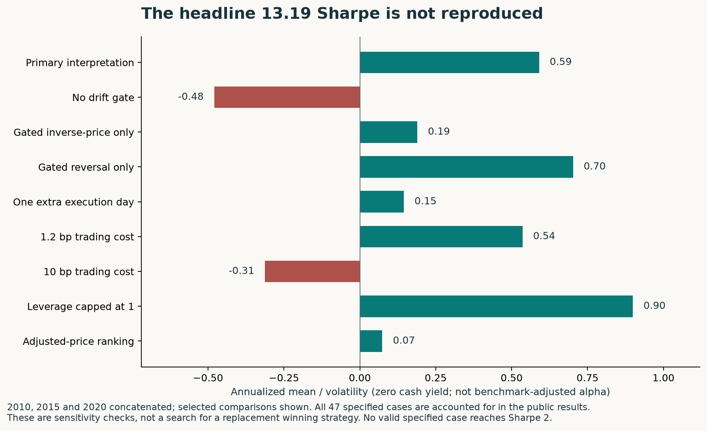
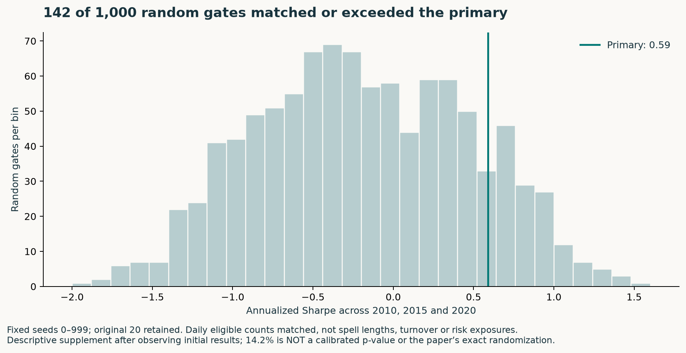
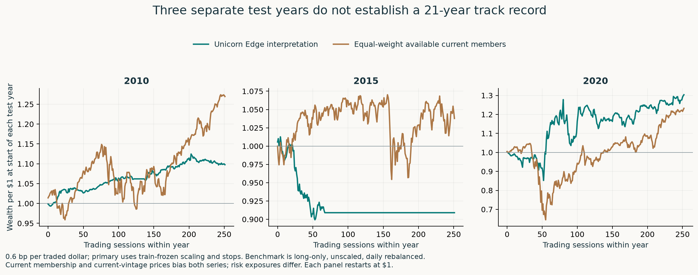
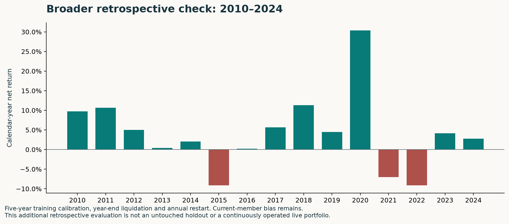

# Unicorn Edge: an independent reproduction and claims audit

[](https://github.com/JoshGutierrez56/unicorn-edge-reproduction/actions/workflows/validate.yml)

**Does the paper's simple regime filter really produce a 13-Sharpe strategy? This implementation does not reproduce that result.**

An independently implemented, explicitly scoped study of Mainak Singha's [*Discovery of a 13-Sharpe OOS Factor: Drift Regimes Unlock Hidden Cross-Sectional Predictability*](https://arxiv.org/abs/2511.12490v1), arXiv:2511.12490v1. Code, frozen aggregate returns, failed cases, assumptions and numerical verification are public. Author code and the exact original dataset were unavailable; this is a **methodological reproduction, not an exact replication**.

## Verdict

**Interesting research hypothesis; not established as a deployable investment strategy.** The drift gate helps relative to the ungated blend in this reconstruction, but the extraordinary headline, robustness and wealth claims do not hold up here. A simpler gated-reversal baseline has a higher Sharpe. Results weaken with a realistic additional execution delay, and the inverse-price component depends on arbitrary share-price units.

| Specified comparison | Sharpe | Geometric net return across the three test years |
|---|---:|---:|
| Paper's headline | 13.19 | Paper reports about 110.4× final wealth; see arithmetic audit |
| Primary interpretation | **0.59** | **+30.1%** |
| One extra trading-day execution lag | 0.15 | +3.1% |
| 10 bp per traded dollar | −0.31 | −17.4% |
| Gated reversal without inverse-price blend | 0.70 | +28.6% |
| No drift gate | −0.48 | −18.4% |
| Equal-weight available current constituents, costed | 0.75 | +62.3% |
| SPY adjusted-price benchmark, before trading costs | 0.57 | +37.8% |

These are **2010, 2015 and 2020**, concatenated—not 21 continuous years. The long-only benchmarks have different market exposures; this table is not an alpha estimate. Sharpe here is annualized arithmetic mean divided by volatility with zero cash yield, not a time-varying risk-free excess-return measure.

The primary's geometric annualized return is **9.14%**, annual volatility **17.35%**, and maximum drawdown **24.41%** across the concatenated sample. Its conditional block-bootstrap 95% Sharpe interval is **[−0.39, 1.54]**; that interval does not correct current-constituent bias, researcher selection or specification uncertainty. The additional retrospective annual walk-forward over **2010–2024** produces **0.39 Sharpe / 3.71% CAGR**, with year-end liquidation and annual restart. It is not an untouched holdout.



## How the strategy actually works

1. **Rank inverse share price.** Lower-priced shares receive higher percentile ranks. This is a nominal-price characteristic, **not fundamental value** such as earnings yield or book-to-price.
2. **Measure short-term reversal.** Negate each stock's trailing ten-session total return, then standardize across stocks. Recent losers score higher.
3. **Blend:** `BASE = 0.7 × inverse-price rank + 0.3 × reversal z-score`.
4. **Apply the drift gate.** Keep stocks with positive returns on **more than 60% of the previous 63 sessions**. The signal-day return is excluded from this count, following the paper's equation 2.
5. **Trade relative scores within the gate.** Standardize the remaining nonzero scores. Allocate +50% to positive scores and −50% to negative scores, proportionally; stay flat if both sides cannot be formed. An eligible stock can still be shorted—it is weak *relative to other eligible stocks*.
6. **Scale using training history only:** `min(12% / annual volatility, 15% / |maximum drawdown|)`. This can imply leverage above one; historical calibration does not guarantee future volatility or drawdown limits.
7. **Rebalance, pay costs and enforce stops.** Charge 0.6 bp per dollar bought or sold against drifted holdings, including entry and exit. Stop after a 30% drawdown or 10% loss over 63 sessions, liquidate with costs, and remain in cash until that evaluation period ends.

The intuition is to trade relative-value/reversal differences among stocks experiencing persistent upward drift. That is a testable hypothesis, not evidence that the mechanism produces exceptional returns. Dollar neutrality alone does **not** ensure beta, sector or factor neutrality. No sector hedge is imposed by these stated equations.

## What was tested

- **47 predeclared cases accounted for:** 46 completed, including an explicitly **invalid same-day leakage diagnostic**; one strict 78% drift-threshold case was uncalibratable because all three training windows had zero variation. It has no invented Sharpe or leverage scale.
- Ungated blend, inverse-price-only, reversal-only, equal-side weighting, price-adjustment conventions, nominal-unit perturbation, extra execution lag, two cost levels, short borrow, leverage cap, stop removal, and threshold/window/blend sensitivities.
- A **1,000-seed descriptive random-gate supplement** matches each day's eligible count, not regime spell lengths or turnover. **142 of 1,000** had Sharpe at least as high as the primary (14.2%); the random-gate mean was −0.19. The original 20 observed seeds were retained, then the fixed extension to seeds 0–999 was completed without outcome-based stopping. **14.2% is not a calibrated p-value**, and this is not an exact replication of the paper's randomization procedure. [Protocol, every seed and receipt](results/2026-10-14/random-gate-1000/).
- Alternate endpoint interpretation—2011, 2016 and 2021—returns **0.15 Sharpe**. All calendar years 2010–2024 are also reported, rather than selecting only three favorable years.
- A separate numerical challenger reconciled **100 signal dates**, **3,775 training returns**, training scales and **757 test-day returns**. It uses direct slices/ranks plus a share-and-cash ledger with Brent root-solving, versus the main rolling-signal/dollar-holdings/fixed-point implementation. This is a second implementation by the same authoring agent, **not independent human review**.
- **31 offline tests** cover signal timing, future perturbations, missing held prices, self-financing fees, short costs, stops, compounding, recorded hashes, consistency of every published case and the complete random-gate supplement. Linux/Windows CI runs without requesting provider data.





## Why the paper's headline needs scrutiny

The paper's Table 3 increases wealth from **$9.415 million to $110.376 million** in its final one-year window. That is approximately **+1,072%**, not the **62%** reported for that window. It cannot be reconciled by simply calling 62% an arithmetic annual mean: for daily returns above −100%, `log(final wealth / initial wealth) ≤ sum(daily returns)`. A 62% annual arithmetic mean over 253 sessions bounds that wealth multiple near **1.86×**, not **11.72×**.

The abstract's claim that ±30% parameter changes retain Sharpe above seven also conflicts with Table 6's threshold values of 3.2 and 4.1. These are specific reproducibility concerns, **not claims about intent**. See [the claims audit](docs/CLAIMS_AUDIT.md).

## Evidence boundaries

- **Survivorship bias:** membership is a frozen **October 2026** S&P 500 list applied backward. The paper also uses current constituents, but its exact list/date is unspecified. Neither design is point-in-time. Delisted/former constituents are not reconstructed.
- **Public-data vintage:** Yahoo Close is already split-adjusted; Adj Close is current-vintage dividend/split adjusted. Neither supplies unadjusted historical nominal share prices known at each date. Inverse-price rankings change with adjustment convention and share denomination.
- **Coverage:** 498 of 503 requested constituent histories were available, plus SPY. `FDXF`, `HONA`, `Q`, `SNDK` and `VYLR` had no usable requested-period histories. Prelisting observations stay missing; no synthetic or forward-filled signal histories are substituted. Per-date coverage and acquisition hashes are public.
- **Execution:** the primary assumes a closing-price signal can trade at that same close—optimistic, not a demonstrated achievable fill. The extra-day case is the more conservative execution check. No spread/order-book simulation, borrow locate, market impact, margin financing or capacity claim is established. Base cash earns zero; short borrow is a separate specified sensitivity.
- **Ambiguity:** exact vendor extract, rank convention, proportional versus equal-side weighting, endpoint dates and unspecified extra kill-switch details cannot be recovered from the paper alone. Assumptions are stated rather than silently tuned.
- **Not a prospective study:** the paper and its reported results were known before implementation. No parameter was tuned to recover the headline. Full results and the amendment following an uncalibratable sensitivity are preserved.



## Reproduce

Python **3.11**, [uv](https://docs.astral.sh/uv/), and the committed `uv.lock`:

```bash
uv sync --frozen --extra dev --python 3.11
uv run --frozen pytest -q
uv run --frozen python scripts/build_report_figures.py
```

The first two commands verify the implementation and frozen public outputs **offline**. Rebuilding figures does not rerun the strategy. To acquire your own provider snapshot and rerun:

```bash
uv run --frozen python scripts/download_prices.py --cache ../private-prices
uv run --frozen python scripts/run_research.py --cache ../private-prices --output ../new-study
uv run --frozen python scripts/audit_primary.py --cache ../private-prices --results ../new-study --output ../numerical-audit.json
```

The downloader requires network access and provider availability; current downloads may differ from the archived run. Use a **new output directory**; the runner refuses to overwrite prior summaries. Raw price histories stay outside this repository. The cache manifest records observations, failures, timestamps and hashes. An exact re-run of the frozen market-data snapshot requires obtaining matching data independently; it is not bundled here.

## Start with the evidence

- [Implementation plan](docs/IMPLEMENTATION_PLAN.md) and [run ledger](docs/RUN_LEDGER.md)
- [What data would an exact replication require?](docs/DATA_REQUIREMENTS.md)
- [All case summaries](results/2026-10-14/summary.csv), [per-window results](results/2026-10-14/windows.csv), [uncalibratable case](results/2026-10-14/unavailable-cases.json)
- [Frozen protocol](results/2026-10-14/run-specification.json), [run receipt](results/2026-10-14/run-receipt.json), [numerical audit](results/2026-10-14/numerical-audit.json)
- [Primary daily record](results/2026-10-14/primary-daily.csv), [all-year evaluation](results/2026-10-14/annual-walk-forward.csv), [coverage](results/2026-10-14/coverage.csv)
- [Source signals](src/unicorn_edge/signals.py), [accounting engine](src/unicorn_edge/engine.py), [source paper](https://arxiv.org/abs/2511.12490v1)

Built by Josh Gutierrez with AI-assisted implementation and verification. The value of this project is its inspectable research process—including the failure to reproduce an extraordinary result—not a claim of profitable live trading. Original implementation: [MIT](LICENSE). The membership snapshot is ODC-PDDL-1.0; source attribution is in its [receipt](docs/universe-receipt.json). The paper and provider price histories are not redistributed.
