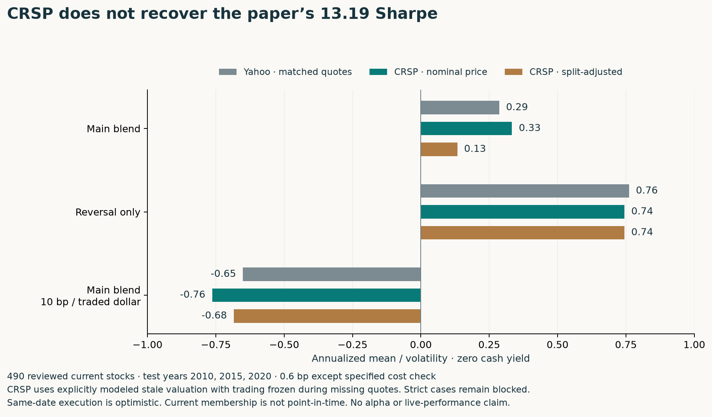

# CRSP does not rescue the 13-Sharpe headline

**The corrected licensed-data follow-up yields 0.33 Sharpe using nominal prices and 0.13 using split-adjusted prices for the main three test years—not 13.19.** These are explicitly modeled missing-quote cases; strict CRSP cases remain incomplete. Better data strengthens the negative reproduction finding, but does not identify the author's actual error or establish an exact replication.

## Like-for-like diagnostic, with visible limitations

The study uses 490 issuer-reviewed current stocks observed by both Yahoo and CRSP, the same signal-date eligibility mask, unchanged strategy parameters, five-year training windows and test years 2010, 2015 and 2020. These are three separated years, not a continuous 21-year track record. Cash earns zero; Sharpe is arithmetic mean divided by volatility, not risk-free-adjusted alpha.

| Current-member comparison | Main blend Sharpe | Gated reversal Sharpe | Main blend at 10 bp |
|---|---:|---:|---:|
| Yahoo, matched quote-freeze convention | 0.287 | 0.762 | −0.651 |
| CRSP nominal price, modeled stale mark/freeze | **0.333** | 0.744 | −0.763 |
| CRSP split-adjusted price, modeled stale mark/freeze | **0.133** | 0.744 | −0.684 |

The CRSP nominal main blend compounds to **+13.60%** over the three test years (4.34% geometric annualized), with **17.11% annual volatility** and **25.48% maximum drawdown**. The split-adjusted version compounds to +2.66%. An extra execution day yields Sharpe 0.320 nominal / 0.188 split-adjusted. The result is convention-sensitive, but neither convention is remotely close to the headline. The reversal-only equality across CRSP price variants is expected: that baseline does not use inverse price.

The separately labeled 2010–2024 annual-restart exercise yields **0.295 Sharpe / 2.49% CAGR** for CRSP nominal and **0.357 / 3.20%** for CRSP split-adjusted. Yearly liquidation/restart and training recalibration are part of that design. These are retrospective diagnostics, not untouched final tests.

The original 498-name Yahoo result (0.590 Sharpe) is preserved. The matched 490-name Yahoo result is 0.287; the universe and eligibility comparison changed. Do not attribute the whole difference between original Yahoo and CRSP to the data vendor.

## Why the strict cases stop

Of 30 declared comparisons, **17 completed and 13 remain blocked**. Every case is retained in the public accounting; partial windows are named `PARTIAL`, never presented as full-case results. There are 35 blocked window attempts across the main and annual analyses, including repeated overlapping training windows.

CRSP contains missing-price intervals. Six intervals covering seven sessions have documented P1/P2 cumulative returns on resumption. The separate sensitivity carries the prior valuation during those intervals and freezes actual holdings until a quote returns. It applies the full cumulative move on resumption, does not insert zeros into signal lookbacks and does not let a stop eliminate a locked loss. Such stale marks can understate intra-interval volatility; this is a valuation convention, not proof of an executable closing price. Unresolved longer gaps remain hard failures, including the ungated variants. No event-cause claim is inferred from a missing-price flag alone.

The strict and modeled cases are both published. It would be misleading to announce complete institutional-data verification while discarding the strict failures.

## Identity, provenance and access

- Acquisition saved 2,389,055 licensed rows privately. A full review of 495 ticker candidates rejected three different-issuer collisions. Eight unmatched/ambiguous symbols were already excluded; two reviewed candidates had no in-period observations. Remaining approved rows: 2,378,539, spanning 490 observed current companies.
- A bare ticker is not a stable issuer identifier. The initial private diagnostic preceded the issuer review and was **not accepted as a valid CRSP comparison**. Its outputs remain private for audit; the corrected run was frozen at `979e20b` before evaluation.
- Daily CRSP access succeeded. The actual historical S&P membership query was denied by the account's index-schema permission. Current constituents are still applied backward: **survivorship bias is not repaired**.
- CRSP CIZ total returns are used directly. A legacy delisting return is not added again. Raw rows, permanent-ID mappings and the identity review are not redistributed.
- CRSP is not identified as the paper's original vendor. Author source code, exact extract, universe freeze and daily position/P&L records are still unavailable.

## Verification

A second implementation checked **300 signal dates**, **11,325 training observations**, all nine train-frozen scales and **2,271 evaluation returns** across Yahoo quote-freeze and both CRSP modeled primary variants. Direct-window ranks and a separate total-return-unit share/cash ledger with a Brent fee solver agree with the production rolling-signal/dollar-holdings/fixed-point engine within 1e−10. The two implementations were written by the same agent; this is numerical reconciliation, not independent human review.

[Frozen plan and amendments](CRSP_FOLLOWUP_PLAN.md) · [Runbook](CRSP_RUNBOOK.md) · [All aggregate outputs](../results/2026-10-14/crsp-followup/) · [Numerical audit](../results/2026-10-14/crsp-followup/numerical-audit.json)

**Investment conclusion:** there is a plausible short-term reversal hypothesis inside the drift gate, but no demonstrated 13-Sharpe opportunity. The inverse-price blend adds fragility here, modeled costs matter, and missing execution/borrow/capacity evidence prevents treating these backtests as a live recommendation.
