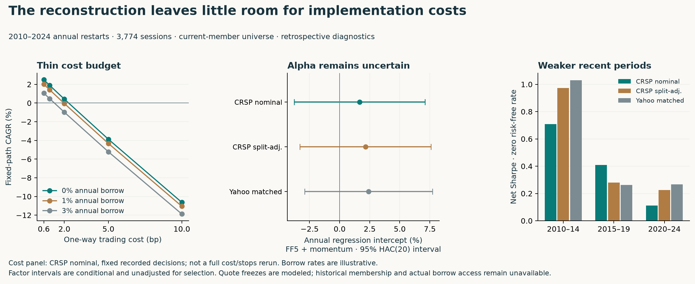

# Further platform tests: a thin edge, not established alpha

**The broader tests do not make Unicorn Edge investable.** In the 2010–2024 CRSP nominal-price reconstruction, a fixed-path overlay of **2 bp per traded dollar plus 1% annual short borrow leaves −0.05% CAGR**. A six-factor regression gives a **1.67% annual arithmetic intercept**, but its HAC(20) 95% interval spans **−3.77% to +7.10%**. Neither result supports the paper's extraordinary claim.



This is the owner's requested reuse of existing research tools. The [extension plan](PLATFORM_STRESS_TEST_PLAN.md) was frozen at `a84c3ef` before these diagnostics; the CRSP strategy outcomes were already known. This is **retrospective diagnosis, not an untouched holdout, parameter search or proof that the true alpha is zero**. All three annual-restart series contain 3,774 observations. Current membership, modeled missing-quote freezes, optimistic same-close execution and zero cash yield remain unchanged.

## 1. The economic margin is small

CRSP nominal-price annual reconstruction, with fixed recorded holdings/decisions:

| Trading cost per dollar | Illustrative annual borrow | Net Sharpe | CAGR |
|---|---:|---:|---:|
| 0.6 bp | 0% | 0.295 | 2.49% |
| 0.6 bp | 3% | 0.155 | 1.06% |
| 2 bp | 0% | 0.092 | 0.42% |
| 2 bp | 1% | 0.045 | −0.05% |
| 2 bp | 3% | −0.049 | −0.98% |
| 5 bp | 0% | −0.344 | −3.88% |
| 10 bp | 0% | −1.072 | −10.63% |

The annual absolute traded notional is **145.70 times NAV**, averaged over the sample; mean short exposure is **46.87% of opening NAV**. Arithmetic-mean break-even trading cost, before borrow, is **2.63 bp**. That is not geometric break-even, a measured spread, a capacity estimate or an executable quote. Split-adjusted CRSP and matched Yahoo have arithmetic break-even costs of 3.03 and 3.16 bp.

All **45** combinations of three providers, five fee levels and three borrow rates are published. Daily costs use the recorded turnover and short exposure; the 0.6-bp/zero-borrow path reconciles with the original published net returns. The overlays **do not recalculate target scales, future holdings, stops or liquidation timing** under changed costs. They must not be confused with the separately published full 10-bp reruns over the three selected test years. Financing on leverage, locate failures and name-specific borrow are not modeled here.

## 2. Factor controls do not establish positive alpha

Regress daily net returns **minus daily RF** on CAPM and FF5 plus momentum. Data come directly from the official Kenneth French library, current 202608 vintage; percent returns are converted to decimals. Every strategy date is matched: no missing-date deletion. The regression does not add interest income to the strategy's zero-yield cash ledger.

| Series | Annual FF5+MOM intercept | HAC(20) 95% interval | Market beta | R² |
|---|---:|---:|---:|---:|
| CRSP nominal | 1.67% | [−3.77%, 7.10%] | 0.030 | 3.30% |
| CRSP split-adjusted | 2.15% | [−3.30%, 7.61%] | 0.039 | 2.70% |
| Yahoo matched | 2.40% | [−2.92%, 7.71%] | 0.040 | 2.37% |

All **12** model/provider/HAC-lag combinations are reported, including lags 5 and 20. Every intercept interval includes zero. Average market exposure is small in this fitted sample, but that does not establish date-by-date beta, industry or liquidity neutrality. Intercepts and their intervals are conditional retrospective estimates, not causal effects, tradable alpha or selection-adjusted inference. Annual intercepts are daily intercept × 252, **not CAGR**. Bartlett HAC uses the finite-sample correction and normal-reference intervals.

## 3. The result depends on period and specification

| CRSP nominal period | Net Sharpe | CAGR |
|---|---:|---:|
| 2010–2014 | 0.709 | 3.55% |
| 2015–2019 | 0.408 | 3.34% |
| 2020–2024 | 0.113 | 0.60% |

All **45 individual year rows and nine fixed-era rows** are retained for the three annual primaries. These are calendar partitions, not fitted economic regimes.

The paired circular-block analysis uses 2,000 resamples per comparison, seed 20261014 and blocks of 5/20/60 sessions, adapting the existing Personalized Model Portfolios design. The three separated test years are resampled **within each year**, never bridged as if 2010 and 2015 were consecutive trading dates. All 15 specified comparisons completed with zero undefined-Sharpe resamples.

- Annual nominal-versus-split and nominal-versus-Yahoo Sharpe-difference intervals span zero at every block length. This is uncertainty, not equivalence.
- On the three original evaluation years, the main blend trails gated reversal by 0.411 Sharpe in nominal CRSP. Its intervals are [−1.121, 0.295], [−1.007, 0.135], [−0.903, −0.022] for blocks 5/20/60.
- The sign of the point estimate favors the simpler reversal baseline, but the interval's exclusion of zero **depends on block choice**. Do not select the most favorable interval or interpret these descriptive, unadjusted results as a definitive hypothesis test. Full split-adjusted/Yahoo comparisons are also published.

## 4. What the existing platforms actually verified

**Backtest Autopsy, read-only:** ran the three full annual aggregate series through the existing component. Its supplied-net observation counts, compounding, volatility and Sharpe reconcile to direct calculations. Its gross-return concentration diagnostic shows the five best days account for **61.34% of summed gross daily returns** for nominal CRSP. That is an arithmetic concentration measure with losses in the denominator, not 61% of terminal wealth or profits attributed to particular trades. Gross leave-one-year-out and clipped-tail diagnostics are included.

The audit also preserves no-holdout, missing signal/position/trade inputs and multiple-testing-disclosure warnings. Aggregate returns cannot validate information timestamps, security exposures, fills or point-in-time membership. **No clean-audit badge is claimed.** No instrument-level trade file was fabricated merely to populate an audit field.

Compatibility probes identified exclusions: the reused drawdown implementation omits starting wealth, its active-return compound is not relative wealth, and its Sortino convention differs. Those metrics are withheld; the tested study accounting supplies drawdown. Its IID interval is replaced by paired blocks. Without a trade file its cost scenarios infer zero turnover, so those scenarios and their economic-erasure finding are also withheld. Actual turnover comes from the separate study ledger above. Private source code was not modified or redistributed.

**Portfolio Alpha & Risk Attribution Lab, read-only:** its existing panel contract accepted all 3,774 aligned aggregate observations and rejected four injected faults: missing values, duplicated dates, unsorted dates and a −100% return. Its implemented long-only funded ledger was **not** used to validate this long/short strategy.

**Personalized Model Portfolios:** reused the paired circular-block design, with attribution and a recorded source hash. The new estimands, year segmentation and uncertainty reporting are tested here. This is reuse of a statistical control, not a claim that prior portfolio tests independently validate Unicorn Edge.

## Reproduce and inspect

```bash
uv sync --frozen --extra dev --python 3.11
uv run --frozen pytest -q
uv run --frozen python scripts/download_stress_factors.py --output ../new-factor-snapshot
uv run --frozen python scripts/run_platform_stress.py --factors ../new-factor-snapshot --output ../new-platform-study
uv run --frozen python scripts/build_platform_figure.py
```

The figure uses published outputs, not newly acquired factors. The diagnostic runner uses only already-public aggregate strategy records plus public factors; it does not require CRSP credentials. Future factor-library revisions may change results; archive hashes and vintage identify this run. Optional read-only platform adapters require the owner's private installations and do not make those codebases public. All core economic, factor and resampling diagnostics are independently runnable from this repository.

- [Every result and receipts](../results/2026-10-14/platform-stress/)
- [Regression, block and cost implementation](../src/unicorn_edge/stress.py)
- [Fixed diagnostic runner](../scripts/run_platform_stress.py)
- [Hand-calculated and independent-matrix tests](../tests/test_stress.py)
- [CRSP acquisition and strategy boundaries](CRSP_FINDINGS.md)

**Decision:** retain the strategy as an instructive replication/audit project, not a demonstrated investment edge. Further implementation polish cannot repair missing historical-universe evidence or create an economic margin the observed results do not show.
